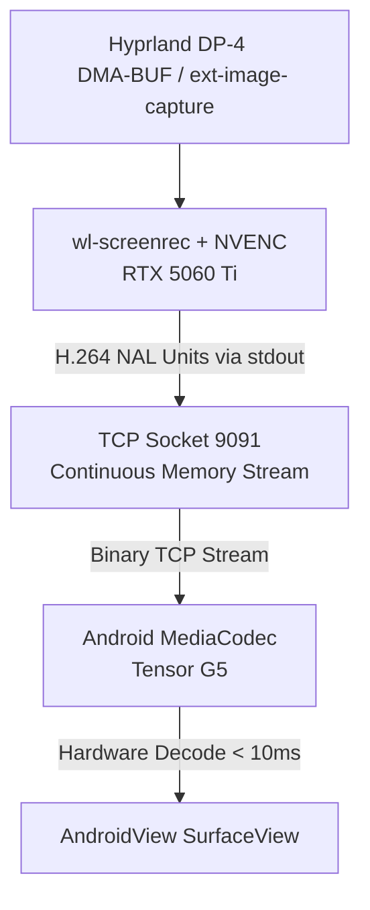

# Molex v1 / v2 Desktop (PC-to-PC + Android)

Molex is an ultra-low latency remote desktop platform designed for controlling Linux Wayland environments (**Hyprland**, **Niri**, Sway, GNOME) across both **PC-to-PC (Tauri v2 Desktop)** and **Android (Jetpack Compose via UniFFI)**.

By leveraging a dual-architecture Rust engine (`molex_motor/`), Molex delivers hardware-encoded H.264 streaming over TCP (`9091`), kernel-level input injection (`uinput` over UDP `9090`), persistent SSH shell/telemetry (`22`), **Tailscale Mesh VPN** management, and **Wake-on-LAN (WoL)**.

---

## 🏗️ Monorepo Architecture

```
molex_v1/
├── molex_motor/               # Rust Native Engine Workspace
│   ├── client/                # Shared Core Library (`molex_core` / UniFFI `client`)
│   │   ├── src/
│   │   │   ├── lib.rs         # Optional `uniffi-bindings` feature gating
│   │   │   ├── models.rs      # DeviceProfile (LAN/Tailscale/WoL), MonitorInfo, Metrics
│   │   │   ├── shell.rs       # Persistent `current_dir` SSH command wrapper & ANSI strip
│   │   │   ├── ssh_video.rs   # Async + UniFFI SSH session & telemetry client
│   │   │   ├── wm.rs          # Multi-compositor Wayland detection (Hyprland, Niri, wlr-randr)
│   │   │   ├── udp_input.rs   # Ultra-low-latency UDP input sender (`M:`, `C:`, `W:`, `K:`)
│   │   │   ├── tunnel.rs      # Tailscale CLI integration (`status --json`, `up`/`down`)
│   │   │   └── wol.rs         # 102-byte Magic Packet sender & WoL+Tailscale readiness poll
│   └── daemon/                # Host Linux Daemon (`molex_daemon`)
│       └── src/
│           ├── monitor.rs     # Hyprland / Niri / wlr-randr monitor auto-detection
│           ├── video_server.rs# TCP :9091 `wl-screenrec` H.264 streamer (`TCP_NODELAY`)
│           ├── udp_server.rs  # UDP :9090 FIFO input dispatcher + dynamic monitor switch
│           └── virtual_device.rs # `evdev::uinput` pointer, wheel & full 1..=255 keyboard
├── src-tauri/                 # Tauri v2 Desktop Rust Backend (`molex_desktop`)
│   └── src/
│       ├── lib.rs             # Tauri IPC commands & state management
│       ├── video_decoder.rs   # FFmpeg low-delay H.264 decoder -> local binary WebSocket
│       └── storage.rs         # Persistent device & desktop settings (`~/.config/molex`)
├── src/                       # Desktop Frontend (React + TypeScript + Tailwind + WebGL YUV)
├── scripts/                   # Boot & Wayland session setup for Arch (systemd) & Gentoo (OpenRC)
└── app/                       # Android Frontend (Kotlin & Jetpack Compose)
```

---

## 🖥️ PC-to-PC Desktop Quick Start (Tauri v2)

### Build & Run Desktop Client
```bash
npm install
npm run build
cargo build --manifest-path src-tauri/Cargo.toml
# Or run dev mode:
npm run tauri dev
```

### Build & Install Host Daemon (`molex_daemon`)
```bash
./scripts/install-host-daemon.sh
```
See [scripts/README.md](scripts/README.md) for **Arch Linux (systemd)** and **Gentoo Linux (OpenRC)** boot/WoL/Wayland autostart setup.

---

## 🚀 Despliegue Rápido en una Laptop Nueva (Cliente y Host)

### Modo Cliente (solo controlar tu workstation desde una laptop nueva)
No necesitas instalar Node.js, npm ni Rust en la laptop cliente:

1. **Instala y activa Tailscale VPN** según tu distribución:
   - **Arch Linux:**
     ```bash
     sudo pacman -S tailscale webkit2gtk-4.1 ffmpeg
     sudo systemctl enable --now tailscaled
     sudo tailscale up --operator=$USER
     ```
   - **Gentoo Linux:**
     ```bash
     sudo emerge -av net-vpn/tailscale net-libs/webkit-gtk media-video/ffmpeg
     sudo rc-update add tailscaled default && sudo rc-service tailscaled start
     sudo tailscale up --operator=$USER
     ```
   - **Debian / Ubuntu:**
     ```bash
     curl -fsSL https://tailscale.com/install.sh | sh
     sudo apt update && sudo apt install -y libwebkit2gtk-4.1-0 libavcodec-dev libavutil-dev libswscale-dev
     sudo tailscale up --operator=$USER
     ```
2. **Ejecuta el binario portable o AppImage** compilado (`npm run tauri build`):
   ```bash
   chmod +x ./molex-desktop   # o ./Molex_*.AppImage
   ./molex-desktop
   ```
3. **Importa el equipo:** En **Dispositivos**, busca tu workstation en **Nodos detectados en Tailnet**, pulsa **+ Guardar**, añade tu usuario/contraseña SSH (o usa llave SSH) y pulsa **Conectar** (la MAC Ethernet se autodetecta automáticamente en segundo plano o desde **Detectar MAC por SSH**).
   - *Tip Wake-on-LAN desde fuera de la LAN:* Si vas a encender la workstation desde otra red, configura el campo **Relay WoL por SSH** con un nodo siempre encendido dentro de la LAN destino (ej. `pi@100.64.0.99`).

### Modo Host (convertir la laptop en equipo controlable)
```bash
./scripts/install-host-daemon.sh
# En Arch Linux:   ./scripts/setup-arch-host.sh
# En Gentoo Linux: ./scripts/setup-gentoo-host.sh
# En Debian/Ubuntu (solo cliente/host Wayland con wl-screenrec instalado):
#   asegúrate de iniciar `molex-host-up` con tu sesión Wayland y tener `openssh-server` + `ethtool` activos.
```

---

### 1. Backend (Rust Motor)
- **`client` submodule**: Compiles to a dynamic library (`libclient.so`) using `UniFFI` bindings for Android JNI integration:
  - **`models.rs`**: Shared data types (`ServerProfile`, `SystemMetrics`) and error types.
  - **`wm.rs`**: Hyprland IPC / Wayland monitor discovery and frame capture execution.
  - **`ssh_video.rs`**: SSH2 session handling, remote `executeCommand()`, video streaming via `MolexVideoClient`, and system telemetry polling.
  - **`MolexInputClient`**: Low-latency UDP socket transmission for input events.
- **`daemon` submodule**: Runs as a lightweight Linux daemon on the host machine to inject keyboard and mouse events directly into the Linux kernel via `uinput`/`evdev`.

### 2. Frontend (Android / Kotlin & Jetpack Compose)
- **Framework**: Jetpack Compose (Material 3) with `StateFlow` and Coroutines (`Dispatchers.IO`).
- **`MolexViewModel`**: Asynchronously manages FFI connections, video frames, telemetry polling, SSH terminal commands, and monitor selection state without blocking the Main thread.
- **Navigation & Enforced Routing**: Single-activity architecture enforcing initial entry via `DevicesScreen` / `SessionsScreen` to prevent null client interactions.

---

## ✨ Production Features

- **Low-Latency Wayland Video Streaming**: Uses a high-speed TCP socket (port 9091) streaming JPEG frames natively from the daemon, entirely bypassing SSH encryption bottlenecks.
- **Dynamic Monitor Selection**: Queries real Wayland monitor outputs (e.g., `DP-1`, `HDMI-A-1`) via Rust FFI and renders a semi-transparent dropdown selector overlay on the streaming screen.
- **Interactive SSH Terminal**: Terminal emulator with history retention, non-blocking asynchronous execution, and real-time ANSI escape code filtering (`stripAnsiCodes`).
- **Advanced System Telemetry**: Real-time asynchronous polling via UDP (port 9090) of OS info, CPU load, RAM usage, GPU details, and network status rendered in dedicated Material3 cards.
- **Persistent Profile Management**: In-app SQLite database using Room (`DeviceEntity`, `DeviceDao`, `AppDatabase`) for offline profile persistence, auto-reconnection capabilities, and credentials sanitization (`trim()`).
- **Immersive Full-Screen Desktop View**:
  - Automatically locks landscape orientation on `RemoteScreen`.
  - Dynamically hides the bottom `NavigationBar` for full-screen display.
  - Floating overlay drawer menu for quick navigation and a dedicated **Disconnect** action.
- **Zero-Latency Touch & Mouse Injection Architecture**: Mathematical mapping for ultrawide (21:9) monitors discarding letterbox/pillarbox zones. Translates active Android touch gestures (drag, tap, long press) into normalized relative coordinates (`0.0f` to `1.0f`) based on exact visible bounds and transmits mouse movement/click events via high-speed UDP directly to a virtual Linux `uinput` device bound to Hyprland's native output (e.g. DP-4).
- **Full-Screen Error Overlay**: Catches connection timeouts or FFI exceptions and renders a full-screen dark red alert UI (`Color(0xFF2B0000)`) with error messages and a "Back to Devices" action.

---

## 🐛 Resolved Bugs & Debugging Log

1. **ANR Prevention (Application Not Responding)**:
   - *Problem*: `MolexVideoClient` and `getMonitors()` initialization were previously executed on the Main thread inside `connectToServer()`, causing UI freezes.
   - *Solution*: Refactored `connectToServer()` to launch all UniFFI instantiations and network I/O strictly inside `viewModelScope.launch(Dispatchers.IO)`.

2. **Silent Base64 Decoding Failures**:
   - *Problem*: When Rust returned a plain text bash error instead of a valid Base64 JPEG frame, `BitmapFactory.decodeByteArray()` returned `null` silently, leaving the UI frozen on the last valid frame.
   - *Solution*: Added explicit `null` checks on decoded bitmaps in `startVideoLoop()`. If decoding fails, the error message is logged and `VideoState.Error` is emitted immediately to trigger the red error UI.

3. **Hyprland SSH Environment Blindness**:
   - *Problem*: `hyprctl` commands executed over SSH failed to detect active monitors because SSH non-interactive shells lacked Wayland environment variables.
   - *Solution*: Implemented dynamic socket discovery in Rust (`wm.rs`), scanning `/run/user/1000/hypr` to discover and inject `HYPRLAND_INSTANCE_SIGNATURE` automatically into the SSH environment.

---

## 🔮 Phase 4: Optimization & Release (Upcoming)

1. **Local Storage (SQLite via Room)**:
   - Migration of server profile management from in-memory lists to a persistent SQLite database using Room (`DeviceEntity`, `DeviceDao`, `AppDatabase`).
   - Enables offline profile persistence, automatic reconnection to last known servers, and CRUD operations for saved Wayland hosts.

## 🔮 Phase 4.3: H.264 Video Transport & Hardware Decoding (Upcoming)

### The Roadmap to Zero-Latency Streaming

To eradicate the lag inherent in the provisional `grim` (JPEG on CPU) over TCP architecture, the next definitive step is a full end-to-end H.264 video pipeline.



1. **Backend (Rust Motor Refactor)**:
   - Complete replacement of `grim` snapshot polling.
   - The Linux Daemon will launch a continuous `wl-screenrec` subprocess using `Command::new("wl-screenrec")`.
   - `wl-screenrec` will utilize **NVENC** hardware encoding, and its `stdout` will be directly piped into the high-speed TCP socket on port `9091` as raw H.264 NAL units.

2. **Frontend (Android Client Refactor)**:
   - Deprecation of `BitmapFactory` and Compose's `Image(bitmap)`.
   - Integration of Android's native `android.media.MediaCodec` configured for `video/avc`.
   - Rendering directly onto a low-level `SurfaceView` embedded in Compose via `AndroidView(factory = { SurfaceView(it) })`.
   - Leveraging Android device silicon (e.g., Tensor G5) for ultra-fast hardware decoding, bringing end-to-end display latency below 15ms.

---

## 🚀 Getting Started

### Prerequisites
- **Host (Linux / Wayland)**:
  - Running Wayland compositor (e.g., Hyprland, Sway, GNOME Wayland).
  - `grim` installed for screen capture (`sudo apt install grim` / `pacman -S grim`).
  - SSH server (`sshd`) enabled and accessible.
- **Android Device**:
  - Android 8.0 (API level 26) or higher.

### Building the Project
1. **Compile Rust FFI Bindings**:
   ```bash
   cd molex_motor/client
   cargo build --target aarch64-linux-android --release
   ```
2. **Build Android Application**:
   Open the root project in Android Studio and run:
   ```bash
   ./gradlew assembleDebug
   ```

---

## 🛠️ Tech Stack

- **Frontend**: Kotlin, Jetpack Compose, Material 3, Coroutines, StateFlow, Navigation Compose, Room (SQLite).
- **Backend**: Rust, UniFFI, SSH2, Tokio, uinput, evdev, Hyprland IPC.
- **Platform**: Android SDK, Linux Wayland.
